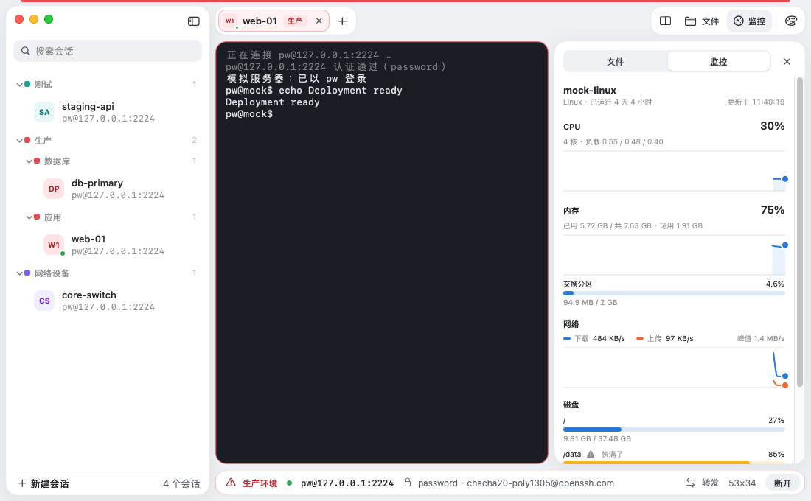
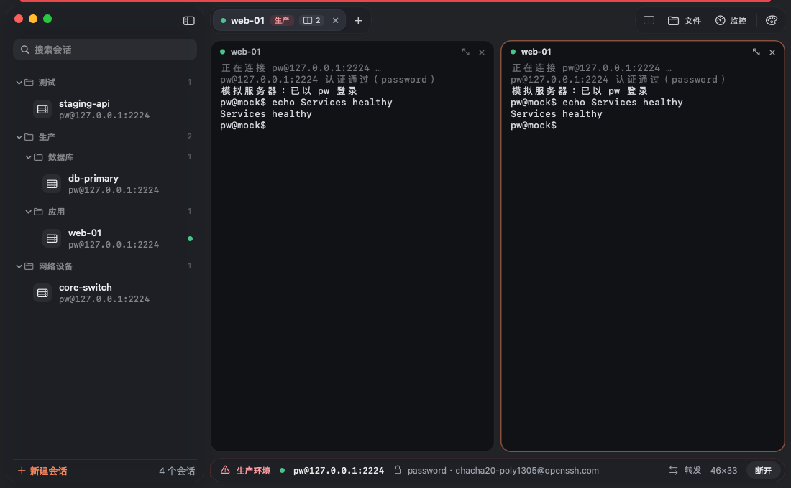
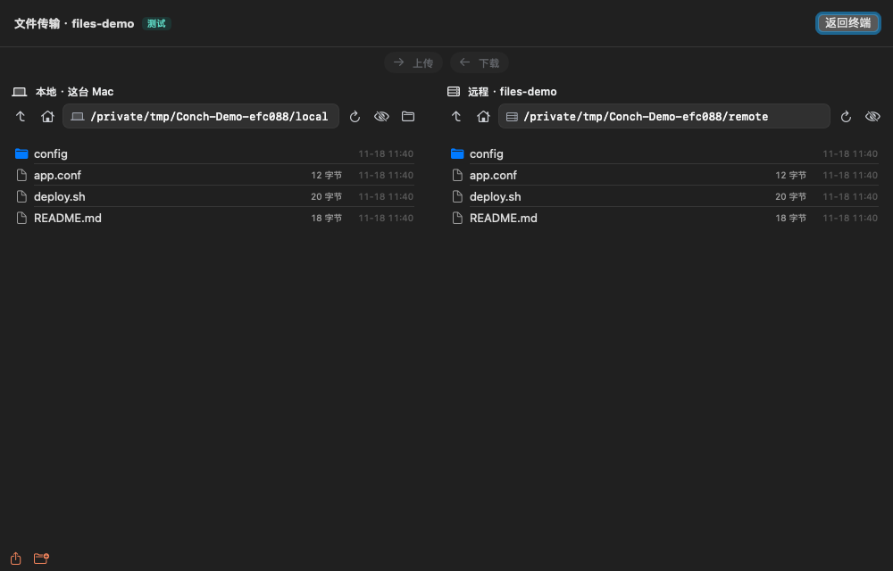

# Conch

English | [简体中文](README.zh-CN.md)

**A native SSH terminal for the Mac.** Built for people who look after lots of servers, switches and routers at once: sessions stay organized in groups, configured production sessions are clearly marked, and SFTP, rz/sz, port forwarding and server monitoring all live in the same window. The connection core is written in Rust ([russh](https://crates.io/crates/russh)); the interface is native SwiftUI + [SwiftTerm](https://github.com/migueldeicaza/SwiftTerm).



- **Current version**: 0.4.2
- **Requirements**: macOS 14 Sonoma or later, on a Mac with Apple silicon (M-series)
- **Language**: the interface is currently in **Simplified Chinese only**. This guide quotes the Chinese labels so you can find them in the app.
- **Privacy**: apart from the SSH and Telnet connections you open yourself, Conch makes no network requests and collects no usage data.

## Features

**Connections**
- SSH, Telnet and serial ports (USB-to-serial adapters)
- Jump hosts, chained to any depth (like `ssh -J a,b`); every hop authenticates and verifies its host key on its own
- Authentication: ssh-agent (including agents such as 1Password and Secretive), private keys, passwords, and the "password + one-time code" logins common on bastion hosts
- Automatic reconnect: retries as soon as the network comes back or the Mac wakes; a normal `exit` on the server does not trigger a reconnect
- Friendly to older devices: legacy algorithms (ssh-rsa, 3des-cbc and others) can be enabled, and GBK, Big5, Shift_JIS and other encodings are supported

**Session management**
- Nested groups and search; groups can be tagged production / testing / device, and production sessions are clearly flagged
- Import from `~/.ssh/config` (including Include, ProxyJump and port forwards) and from Xshell `.xsh` session files
- Quick Connect: type `user@host:port`, a full `ssh` / `telnet` command, or an alias from your ssh_config
- Share sessions between Macs by keeping them in an iCloud Drive (or any synced) folder; passwords are never synced
- Passwords and key passphrases are stored in the macOS Keychain, optionally protected by Touch ID

**Terminal**
- Tabs: they get narrower as you open more, then scroll sideways (a mouse wheel works too); a drop-down at the right lists every tab
- Split panes (side by side or stacked): each pane has a title bar with zoom and close buttons; drag a title bar next to another pane to rearrange, or onto the tab bar to give the pane its own tab
- Right-click in the terminal for copy, paste, find, split and reconnect
- Broadcast input: send your keystrokes to every session in the window at once
- Compose bar with saved commands, find in terminal (with regex), keyword highlighting (error, failed, warning, …)
- Session logs, as plain text (matching what you saw on screen) or raw output, with optional timestamps
- Three switchable looks: Glass (light, translucent), Graphite (dark) and Environment (colors sessions by environment); terminal colors follow along

**Files and networking**
- File panel (SFTP) with two panes: the server on top, this Mac below. Double-click, drag between them, or use the Upload / Download buttons in the middle; both panes can show hidden files. You can also drag files in from Finder. Whole folders, resumable transfers, and a prompt before overwriting a file with the same name
- rz / sz (ZMODEM): send and receive files right in the terminal
- Remote editing: open a server file in your local editor; every save is uploaded automatically
- Port forwarding: local (-L), remote (-R) and SOCKS proxy (-D)
- Server monitor: CPU, memory, network, disks and processes, with charts of the last 3 minutes (Linux servers)



Conch 0.4.2 protects existing files on failed transfers, validates resume content, denies saved credentials when device authentication is unavailable, and improves connection forms and file panels. See the [changelog](CHANGELOG.md).

Expand the file panel for side-by-side local/remote browsing. Sidebar density is configurable, and production labels remain visible in all themes.

SFTP writes hidden temporary files before replacing the destination. Older servers require backup/rollback, so the destination path may briefly disappear; directory transfers are not transactions. Failed/cancelled partial files support verified retries during the current app run. The error includes their location. Replacement requires directory write permission; symlinks are not recursively followed. ACLs, extended attributes and hard-link relationships are not guaranteed to survive replacement. The transfer queue is not restored after restarting the app.

Expanded local/remote file browsing, shown with a local test server and demo files.



## Installation

1. Download the latest `Conch-<version>.pkg` from [Releases](../../releases).
2. Double-click it and follow the installer (Continue, Install), entering your Mac password when asked.
3. Open Conch from Launchpad (called Apps from macOS 26) or the Applications folder.

Releases also include a `.dmg` disk image: open it and drag Conch into the Applications folder.

### If macOS blocks it the first time

The installer is not yet signed with an Apple Developer ID, so macOS warns that it "cannot verify" the package is free of malware. This happens with any unsigned software. To open it:

1. Click **Done** in the warning.
2. Open **System Settings → Privacy & Security**, scroll to the bottom, click **Open Anyway** next to the blocked item, and enter your password.
3. Click **Open Anyway** once more.

Prompts can vary by macOS version, download method and signing identity, and may appear again after an update. Verify the release SHA-256 and install only a version you trust.

If you are comfortable with the Terminal, you can instead remove the download flag before double-clicking the installer:

```bash
xattr -d com.apple.quarantine ~/Downloads/Conch-*.pkg
```

### Updating and uninstalling

- **Update**: install the newer package over the old one. Sessions and settings are kept.
- **Uninstall**: drag Conch from Applications to the Trash. To remove its data as well, delete:
  - `~/Library/Application Support/Conch`: sessions, groups, saved commands, trusted host keys
  - `~/Library/Preferences/com.conch.gado.plist`: settings
  - `~/Library/Logs/Conch`: session logs
  - Keychain Access items whose names start with `Conch：`: saved passwords

## Getting started

1. Open Conch and type `root@10.0.0.5`, `ssh -p 2222 deploy@example.com` or `telnet 192.168.1.1` into **快速连接** (Quick Connect), then press Return.
2. Save servers you use often: once connected, press ⌘I (**保存为会话**, Save as Session), or press ⇧⌘N to create one. Double-click a session in the sidebar to connect.
3. Already have a setup? Use **导入 ~/.ssh/config** (Import ~/.ssh/config) or **导入 Xshell 会话…** (Import Xshell Sessions) at the bottom of the Quick Connect page.
4. The first time you connect to a machine on your local network, macOS asks whether Conch may access the local network. Choose **Allow**, or the connection will fail.
5. Right-click a group in the sidebar → **环境** (Environment) → **生产** (Production), then switch to the **环境色** (Environment) look with the palette button at the top right of the toolbar. When you connect to a production server, a red line appears along the top of the window and the tab is labeled **生产**.

A few more things to try:

- File panel ⌥⌘F, server monitor ⌥⌘U, port forwarding ⌥⌘P. The computer icon in the file panel's title bar hides the local pane
- Run `sz <file>` on a server to download the file to your Downloads folder; run `rz` to pick files to upload
- Settings (⌘,) let you change colors, fonts, logging and saved commands, and set up a sync folder and Touch ID

## Keyboard shortcuts

| Action | Shortcut |
|---|---|
| New tab / new window | ⌘T / ⌘N |
| Close tab (or the current pane when split) / close window | ⌘W / ⇧⌘W |
| New session / edit current session ("Save as Session" for a quick connection) | ⇧⌘N / ⌘I |
| Reconnect | ⌘R |
| Split side by side / split stacked | ⌘D / ⇧⌘D |
| Switch pane / zoom current pane | ⌘] / ⌘[, ⇧⌘↩ |
| Switch tab | ⌘1…⌘9, ⇧⌘[ / ⇧⌘] |
| Start / stop logging | ⌥⌘L |
| Bigger / smaller / default font size | ⌘+ / ⌘- / ⌘0 |
| Clear scrollback | ⌘K |
| Show / hide the session sidebar | ⌃⌘S |
| Find / next / previous | ⌘F / ⌘G / ⇧⌘G |
| File panel (SFTP) | ⌥⌘F |
| Server monitor | ⌥⌘U |
| Port forwarding | ⌥⌘P |
| Broadcast input to all sessions | ⌥⌘I |
| Compose bar and saved commands | ⌥⌘B |

## FAQ

**I can't reach servers or devices on my local network.**
macOS asks for your permission before an app can use the local network. Turn Conch on in **System Settings → Privacy & Security → Local Network**.

**After an update, macOS asks again whether Conch may use the Keychain.**
Current builds have no fixed developer signature, so macOS treats each new version as a different app. Click **Always Allow**.

**Where are my passwords stored? Are they safe?**
Passwords and key passphrases live only in the macOS Keychain. They are never written to the session file or synced to other Macs. Under **设置 → 同步与安全** (Settings → Sync & Security) you can require Touch ID or your login password before a saved password is used.

**Does it run on Intel Macs?**
No. Conch is built for Apple silicon only.

**Is there an English interface?**
Not yet. The interface is Simplified Chinese only for now.

**Which servers does the monitor support?**
Linux servers only, for now.

## Building from source

You need:

- A Mac with Apple silicon
- Xcode, or just the Command Line Tools: `xcode-select --install`. Development and testing use Swift 6.4 (macOS 27 SDK); older Xcode versions have not been tried
- The official Rust toolchain manager, rustup. It installs into your home folder and leaves your shell settings untouched:

  ```bash
  curl --proto '=https' --tlsv1.2 -sSf https://sh.rustup.rs | sh -s -- -y --no-modify-path --default-toolchain none
  ```

Clone this repository, then from its folder run:

```bash
scripts/build.sh          # builds the Rust core and the Swift app into build/Conch.app
open build/Conch.app
```

The first build downloads dependencies and compiles everything, which takes a few minutes. Build caches go to `.build-cache/` inside the project and are ignored by Git. Set `CONCH_BUILD_CACHE` to use a different location.

To build the installers:

```bash
scripts/package.sh        # produces build/Conch-<version>.pkg and .dmg
```

The script signs with available Developer ID certificates; notarization runs only when `CONCH_NOTARY_PROFILE` is configured; see the [developer guide](docs/DEVELOPMENT.md#签名和公证让别人双击就能装) (in Chinese).

To run the tests:

```bash
scripts/test-sshd.sh start    # starts local SSH and Telnet test servers
scripts/core-tests.sh         # Rust core tests
scripts/app-tests.sh          # unit tests
CONCH_TESTING=1 scripts/build.sh
scripts/app-e2e.sh            # end-to-end UI tests for the isolated test app
scripts/test-sshd.sh stop
```

Architecture, project layout, testing details and the development log are in the [developer guide](docs/DEVELOPMENT.md) (in Chinese).

## Built with

- [russh](https://crates.io/crates/russh) and [russh-sftp](https://crates.io/crates/russh-sftp): SSH and SFTP
- [SwiftTerm](https://github.com/migueldeicaza/SwiftTerm): terminal emulation
- [UniFFI](https://crates.io/crates/uniffi): the bridge between Rust and Swift
- [tokio](https://crates.io/crates/tokio), [zmodem2](https://crates.io/crates/zmodem2), [encoding_rs](https://crates.io/crates/encoding_rs)

## License

[MIT](LICENSE)

## Contributing and reporting

See [Contributing](CONTRIBUTING.md), [Security](SECURITY.md), [Release preparation](docs/RELEASING.md) and [Third-party notices](THIRD_PARTY_NOTICES.md). Use redacted logs and demo hosts. Real two-Mac sync, serial hardware and macOS 14 validation remain outstanding.
