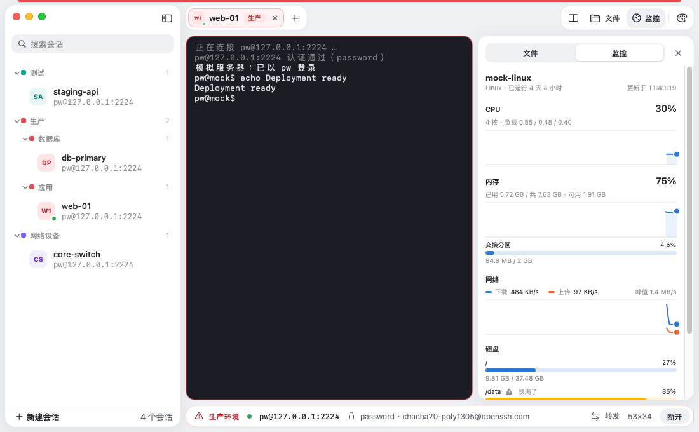
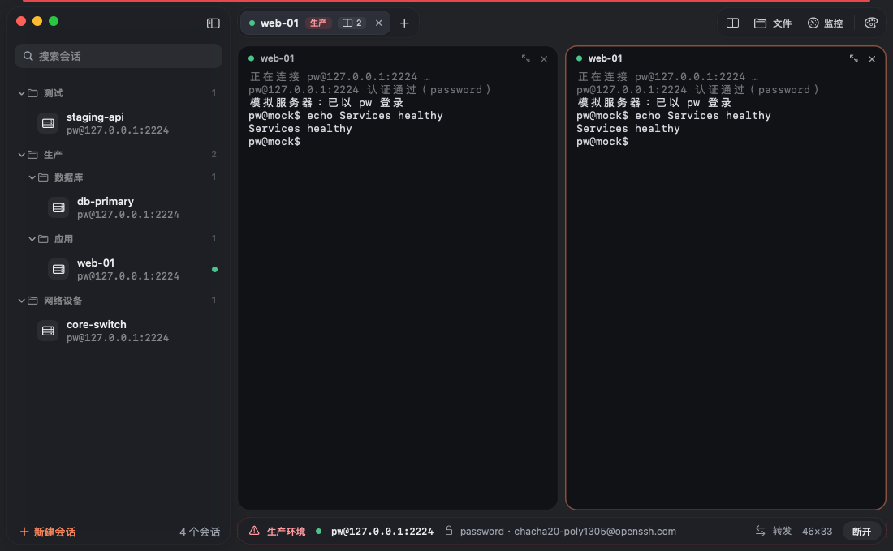
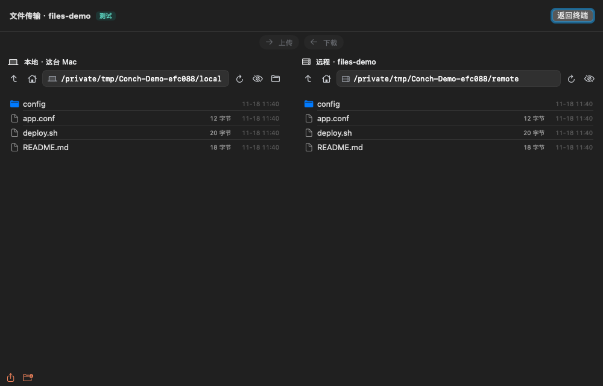

# Conch

[English](README.md) | 简体中文

**Mac 原生的 SSH 终端。** 写给同时管着一堆服务器、交换机和路由器的人：会话按分组管好，已标记的生产会话有醒目提示，SFTP、rz/sz、端口转发、服务器监控都在同一个窗口里。连接内核用 Rust（[russh](https://crates.io/crates/russh)）写，界面是原生的 SwiftUI + [SwiftTerm](https://github.com/migueldeicaza/SwiftTerm)。



- **当前版本**：0.4.2
- **系统要求**：macOS 14 Sonoma 或更新，Apple 芯片（M 系列）的 Mac
- **界面语言**：目前只有简体中文
- **隐私**：网络活动用于你启用的连接、端口转发和文件传输，不收集使用数据

## 功能

**连接**
- SSH、Telnet、串口（USB 转串口线）
- 跳板机，可以多级（相当于 `ssh -J a,b`），每一跳单独认证、单独校验主机密钥
- 认证：ssh-agent（也支持 1Password、Secretive 这类 agent）、私钥、密码，以及堡垒机常用的“密码 + 动态口令”
- 断线自动重连：网络恢复、电脑唤醒后马上重试；在服务器上正常 `exit` 不会重连
- 老设备友好：可以打开旧算法（ssh-rsa、3des-cbc 等），支持 GBK、Big5、Shift_JIS 等编码

**会话管理**
- 多级分组、搜索；分组可以标成“生产 / 测试 / 设备”，连到生产环境时醒目提示
- 从 `~/.ssh/config`（包括 Include、ProxyJump、端口转发）和 Xshell 的 .xsh 会话文件导入
- 快速连接：直接输入 `user@host:端口`、一整条 `ssh` / `telnet` 命令，或者 ssh_config 里的别名
- 多台 Mac 共用会话：放进 iCloud 云盘或其他同步盘的文件夹（密码不同步）
- 密码和私钥口令存在系统钥匙串里，可以设置成用之前先过 Touch ID

**终端**
- 标签页：开多了自动变窄，放不下时左右滚动（鼠标滚轮也能翻），右边的下拉按钮列出所有标签页
- 分屏（左右 / 上下）：每个分屏上面有标题栏，可以放大、关闭；按住标题栏拖到别的分屏旁边换位置，拖到标签栏变成单独的标签页
- 终端里右键：拷贝、粘贴、查找、分屏、重新连接
- 同步输入：一次把键盘输入发给窗口里所有会话
- 撰写栏和快捷命令、终端里查找（支持正则）、关键字高亮（error、failed、warning……）
- 会话日志：存成纯文本（和屏幕上看到的一样）或原始输出，可以加时间戳
- 三套外观随时切换：玻璃（浅色半透明）、石墨（深色）、环境色（按环境给会话上色），终端配色跟着变

**文件和网络**
- 文件面板（SFTP）分上下两栏：上面是服务器，下面是本机，对照着双击、拖动或点中间的“上传 / 下载”就能传；两栏都可以显示隐藏文件。也能从访达拖进来上传；整个文件夹传输、断点续传；同名文件覆盖前先问
- rz / sz（ZMODEM）：在终端里直接收发文件
- 远程编辑：用本机的编辑器打开服务器上的文件，保存后自动传回
- 端口转发：本地（-L）、远程（-R）、SOCKS 代理（-D）
- 服务器监控：CPU、内存、网络、磁盘、进程，画出最近 3 分钟的曲线（Linux 服务器）



0.4.2 修复了覆盖传输、续传和身份验证不可用时的处理，并优化了表单和文件对照视图。同步冲突会保留本机备份。跨窗口的远端文件拖放会被拒绝。详见[更新记录](CHANGELOG.md)。

文件面板支持“展开文件传输”左右对照；侧边栏可在设置中切换紧凑模式。生产环境文字提示在三套主题下始终显示。

SFTP 先写隐藏临时文件，成功后替换目标。部分服务器需要备份／回滚，目标路径可能短暂不可见；整个文件夹不是一个事务。失败、取消后保留临时文件供本次运行内重试，错误会给出路径。覆盖需目录写权限，不自动递归符号链接；ACL、扩展属性和硬链接关系不保证保留。

下图为展开后的本地／远端文件对照视图，截图使用本机测试服务器和示例文件。



## 安装

1. 到 [Releases](../../releases) 下载最新的 `Conch-版本号.pkg`。
2. 双击安装包，按提示点“继续”“安装”，输入开机密码。
3. 装好后，在启动台（macOS 26 起叫“App”）或“应用程序”文件夹里打开 Conch。

Releases 里也有 `.dmg` 磁盘映像，打开后把 Conch 拖进“应用程序”文件夹即可。

### 第一次打开时被系统拦下

现在的安装包还没有 Apple 开发者签名，macOS 会提示“Apple 无法验证……是否包含恶意软件”。具体提示因系统版本和下载方式而异，可按系统提供的入口确认：

1. 在提示框里点“完成”。
2. 打开“系统设置 → 隐私与安全性”，拉到最下面，在“已阻止……”那一行点“仍要打开”，输入开机密码。
3. 再点一次“仍要打开”。

提示可能随 macOS 版本、下载方式和签名身份变化；升级时也可能再次确认。请先核对 Release 中的 SHA-256，仅安装你信任的版本。

熟悉终端的话，也可以先去掉下载标记，再双击安装包：

```bash
xattr -d com.apple.quarantine ~/Downloads/Conch-*.pkg
```

### 升级和卸载

- **升级**：直接安装新版本的安装包，会话和设置都会保留。
- **卸载**：把“应用程序”里的 Conch 拖到废纸篓。想把数据也清干净，再删掉：
  - `~/Library/Application Support/Conch`：会话、分组、快捷命令、信任过的主机
  - `~/Library/Preferences/com.conch.gado.plist`：设置
  - `~/Library/Logs/Conch`：会话日志
  - “钥匙串访问”里名称以“Conch：”开头的条目：保存的密码

## 快速上手

1. 打开 Conch，在“快速连接”里输入 `root@10.0.0.5`、`ssh -p 2222 deploy@example.com` 或 `telnet 192.168.1.1`，回车就连。
2. 常用的服务器存成会话：连上以后按 ⌘I“保存为会话”，或者按 ⇧⌘N 新建。以后在左边的会话列表里双击就能连。
3. 已经有配置的话，点快速连接页下面的“导入 ~/.ssh/config”或“导入 Xshell 会话…”。
4. 第一次连局域网里的机器时，系统会问是否允许 Conch 访问本地网络，要选“允许”，否则连不上。
5. 在会话列表里右键分组 →“环境”，标成“生产”；再点工具栏右上角的调色板按钮，换成“环境色”外观。连到生产服务器时，窗口顶部会出现一条红线，标签页上写着“生产”。

还有这些常用操作：

- 文件面板 ⌥⌘F，服务器监控 ⌥⌘U，端口转发 ⌥⌘P。文件面板标题栏上的电脑图标可以收起本机那一栏
- 在服务器上执行 `sz 文件名`，文件会下载到“下载”文件夹；执行 `rz`，会弹出窗口让你选要上传的文件
- 设置（⌘,）里可以改配色、字体、日志、快捷命令，以及同步文件夹和 Touch ID

## 快捷键

| 操作 | 快捷键 |
|---|---|
| 新建标签页 / 新建窗口 | ⌘T / ⌘N |
| 关闭标签页（有分屏时关闭当前分屏）/ 关闭窗口 | ⌘W / ⇧⌘W |
| 新建会话 / 编辑当前会话（快速连接时是“保存为会话”） | ⇧⌘N / ⌘I |
| 重新连接 | ⌘R |
| 左右分屏 / 上下分屏 | ⌘D / ⇧⌘D |
| 切换分屏 / 放大当前分屏 | ⌘] / ⌘[、⇧⌘↩ |
| 切换标签页 | ⌘1…⌘9、⇧⌘[ / ⇧⌘] |
| 开始 / 停止记录日志 | ⌥⌘L |
| 放大 / 缩小 / 默认字号 | ⌘+ / ⌘- / ⌘0 |
| 清除回滚缓冲区 | ⌘K |
| 显示 / 隐藏会话列表 | ⌃⌘S |
| 查找 / 下一个 / 上一个 | ⌘F / ⌘G / ⇧⌘G |
| 文件面板（SFTP） | ⌥⌘F |
| 服务器监控 | ⌥⌘U |
| 端口转发 | ⌥⌘P |
| 同步输入到所有会话 | ⌥⌘I |
| 撰写栏和快捷命令 | ⌥⌘B |

## 常见问题

**连不上局域网里的服务器或设备？**
macOS 要求 App 访问本地网络前先征得你的同意。到“系统设置 → 隐私与安全性 → 本地网络”里打开 Conch。

**更新以后，又要我允许 Conch 访问钥匙串？**
现在的版本没有固定的开发者签名，系统会把新版本当成另一个 App。在弹窗里点“始终允许”就行。

**密码存在哪里？安全吗？**
密码和私钥口令只存在 macOS 的钥匙串里，不写进会话文件，也不会同步到别的 Mac。在“设置 → 同步与安全”里可以打开 Touch ID 保护：用保存的密码之前，先要通过 Touch ID 或登录密码验证。

**Intel 芯片的 Mac 能用吗？**
不能，Conch 只提供 Apple 芯片的版本。

**有英文界面吗？**
暂时只有简体中文。

**服务器监控支持哪些系统？**
目前只支持 Linux 服务器。

## 从源码构建

需要准备：

- Apple 芯片的 Mac
- Xcode，或者只装命令行工具：`xcode-select --install`。目前是用 Swift 6.4（macOS 27 SDK）开发和测试的，更老的 Xcode 没试过
- Rust 官方工具链 rustup，固定 Rust 1.99.1（装在你的用户目录里，不会改终端设置）：

  ```bash
  curl --proto '=https' --tlsv1.2 -sSf https://sh.rustup.rs | sh -s -- -y --no-modify-path --default-toolchain none
  ```

克隆这个仓库，在仓库目录里运行：

```bash
scripts/build.sh          # 编译 Rust 内核和 Swift 界面，生成 build/Conch.app
open build/Conch.app
```

第一次构建要下载依赖、从头编译，需要几分钟；编译缓存放在项目的 `.build-cache/`，已加入 Git 忽略；也可通过 `CONCH_BUILD_CACHE` 指定其他位置。

打出安装包：

```bash
scripts/package.sh        # 生成 build/Conch-版本号.pkg 和 .dmg
```

钥匙串里有 Apple 开发者证书时，打包脚本会签名；设置 `CONCH_NOTARY_PROFILE` 后才提交 Apple 公证，设置方法见[开发文档](docs/DEVELOPMENT.md#签名和公证让别人双击就能装)。

运行测试：

```bash
scripts/test-sshd.sh start    # 在本机启动测试用的 SSH、Telnet 服务器
scripts/core-tests.sh         # Rust 内核测试
scripts/app-tests.sh          # 单元测试
CONCH_TESTING=1 scripts/build.sh
scripts/app-e2e.sh            # 独立测试 App 的界面端到端测试
scripts/test-sshd.sh stop
```

架构、目录结构、测试细节和开发记录，都在[开发文档](docs/DEVELOPMENT.md)里。

## 用到的开源项目

- [russh](https://crates.io/crates/russh)、[russh-sftp](https://crates.io/crates/russh-sftp)：SSH 和 SFTP 协议
- [SwiftTerm](https://github.com/migueldeicaza/SwiftTerm)：终端模拟
- [UniFFI](https://crates.io/crates/uniffi)：Rust 和 Swift 之间的接口
- [tokio](https://crates.io/crates/tokio)、[zmodem2](https://crates.io/crates/zmodem2)、[encoding_rs](https://crates.io/crates/encoding_rs)

## 许可证

[MIT](LICENSE)

## 参与和反馈

请阅读[贡献说明](CONTRIBUTING.md)、[安全报告方式](SECURITY.md)、[发布流程](docs/RELEASING.md)和[第三方许可证](THIRD_PARTY_NOTICES.md)。提交 Bug 请使用示例地址和脱敏日志。目前尚未在真实双 Mac 同步、串口硬件及 macOS 14 真机上完成全面验证。
